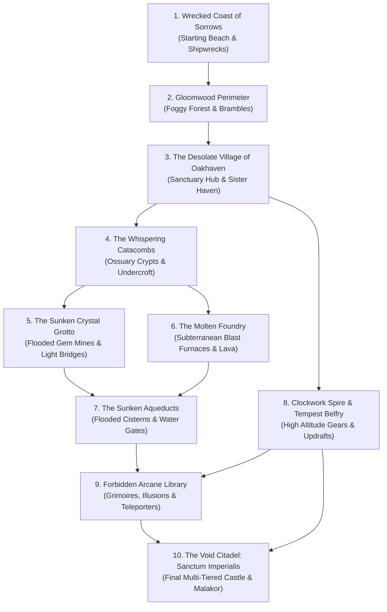

# 🏰 Abyssal Blade: Grand Odyssey Overhaul Architecture Plan

## 1. Executive Summary & Vision
To transform *Abyssal Blade* from a compact vertical slice into a **massive, multi-hour gothic Metroidvania** on the scale of *Castlevania: Order of Ecclesia*, *Portrait of Ruin*, and *Hollow Knight*, we are restructuring the engine around **three core pillars**:

1. **Seamless 10-Zone Interconnected World Topology**:
   - Rather than isolated levels or disconnected arenas, all 10 major biomes connect physically into a cohesive continent. Players can naturally traverse from seaside ruins into ancient forests, through decrepit villages, down into subterranean mines, and upward into towering clocktowers and the Void Citadel.
   - An *Astral Leyline Fast-Travel Network* links key sanctuaries across all 10 zones.

2. **Modular Room-Template Engine & Bulk Generator (Bulk Creation Pipeline)**:
   - Eliminates hardcoded pixel-coordinate scripts in favor of standardized **Room Modules** (e.g. $1\times1$, $2\times1$, $1\times2$, $2\times2$, $3\times1$ grid units of $640\times360$ px per screen).
   - Handcrafted room-template prefabs (Traversal corridors, platforming vertical shafts, combat arenas, treasure vaults, puzzle locks, and boss sanctums) combined with a deterministic layout assembler.
   - Generates **hundreds of interconnected rooms** in seconds with guaranteed solvability, ability-gating, and loopback shortcut doors.

3. **In-Engine Dev Level Editor (`F1` / Mode)**:
   - An interactive visual editor allowing instant inspection, tile stamping, entity/enemy positioning, trigger testing, and one-click JSON exporting without leaving the browser.

---

## 2. World Topology: The 10 Interconnected Zones

### Zone Progression & Ability Gating Matrix
| Zone # | Zone Name | Theme / Environment | Key Ability Required to Access | Unlocked Sister / Major Relic | Regional Boss |
|---|---|---|---|---|---|
| **1** | **Wrecked Coast of Sorrows** | Crashing tides, barnacled shipwrecks, drowned revenants | Starting Zone | Basic Blade & Dodge Roll | Kra’khor, the Tide Caller |
| **2** | **Gloomwood Perimeter** | Haunted pines, thorny brambles, shadow gargoyles | Blade (cut brambles) | **Wren (Zephyr Air Dash)** | Sylva, the Bramble Matron |
| **3** | **Village of Oakhaven (Central Hub)** | Ruined cathedral, sanctuary bonfires, merchant stalls | Air Dash across bridge chasm | Campfire Sanctum & Blacksmith | N/A (Peaceful Hub) |
| **4** | **The Whispering Catacombs** | Stone ossuaries, skeleton phalanxes, iron portcullises | Crypt Relic Key | **Percy (Titan Shield Bash)** | Ossian, the Crypt Warden |
| **5** | **The Sunken Crystal Grotto** | Bioluminescent caverns, hard-light bridges, prisms | Shield Bash (break granite seals) | **Mona (Astral Ray)** | Caelith, the Prismatic Weaver |
| **6** | **The Molten Foundry** | Slag flues, magma cascades, smelting crucibles | Astral Ray (ignite thermal conduits) | Heavy Fire Resistance Rune | Ignis, the Obsidian Colossus |
| **7** | **The Sunken Aqueducts** | Flooded chambers, drain sluices, water leapers | Sluice Valve Wheels | **Tilly (Shadow Grapple Whip)** | Hydros, the Drowned Sovereign |
| **8** | **Clockwork Spire & Tempest Belfry**| Rotating gears, wind drafts, flying storm harpies | Grapple Whip (swing across rings) | Wall-Climb Spikes | Zephyra, Queen of the Tempest |
| **9** | **Forbidden Arcane Library** | Floating grimoires, arcane ward glyphs, mirror rifts | Wall Climb + Astral Ray | Grand Grimoire of Unbinding | Malphas, Keeper of Tomes |
| **10** | **The Void Citadel** | Multi-tiered gothic throne halls, abyssal fissures | All 4 Primordial Sigils | Ultimate Blade Awakening | Malakor Unbound (Final Climax) |

---

## 3. High-Performance Architecture: Room Streaming & Culling

To render hundreds of rooms at 60 FPS in Phaser:

1. **Virtual Room Grid**:
   - Each room is assigned coordinate tiles $(RX, RY)$ with width/height in room units (e.g. $1\times1 = 640\times360\text{ px}$).
2. **Dynamic Entity Simulation Culling**:
   - Only entities in the **active room** and **direct neighboring rooms** are simulated in Arcade Physics.
   - Off-screen rooms are frozen: enemies do not tick, projectiles do not spawn, and particle emitters are paused.
   - When transitioning into a room, dynamic objects wake up seamlessly.
3. **Screen-Edge Sliding Transitions**:
   - Crossing a doorway smoothly pans the camera over 250ms with a directional easing curve, mimicking *Castlevania* / *Metroid* screen transitions.

---

## 4. Bulk Creation Tooling: Dual-Pronged Approach

1. **Room Template Library (Data-Driven)**:
   - Reusable JSON/JS templates for:
     - `CORRIDOR_H` (horizontal combat/platforming)
     - `SHAFT_V` (vertical climb/drop with platforms and wall jumps)
     - `ARENA_TRIAL` (combat lockdown chamber)
     - `PUZZLE_VAULT` (mechanisms, keys, chests)
     - `SANCTUARY` (bonfire, sister rest, warp stone)
     - `BOSS_CHAMBER` (grand double-wide arena)
2. **In-Game Developer Level Editor (`F1` Key)**:
   - Toggleable HUD overlay.
   - Tile brush picker (Solids, One-way platforms, Spikes, Water, Lava, Light Bridges).
   - Entity palette (Enemies, Pickups, Levers, Doors, Boss Triggers).
   - Live room testing: Place the player, immediately test the jump/combat, press `Save/Export`.

---

## 5. Phased Implementation Roadmap

- [ ] **Phase 1: World Matrix & Tile-Room Engine Core**
  - Implement `RoomEngine.js` with $640\times360$ screen chunking, room coordinate registry, and camera slide transitions.
  - Implement entity pooling and off-screen room culling.
- [ ] **Phase 2: In-Game Developer Room Editor (`F1`)**
  - Visual grid overlay, tile painter, entity stamp tool, and JSON importer/exporter.
- [ ] **Phase 3: The 10-Zone World Graph & Macro Layout**
  - Implement all 10 interconnected zones with entrance/exit gates and world-map tracking.
  - Connect Coast &rarr; Forest &rarr; Village &rarr; Catacombs &rarr; Grotto &rarr; Foundry &rarr; Aqueducts &rarr; Spire &rarr; Library &rarr; Citadel.
- [ ] **Phase 4: Bestiary & Boss Expansion**
  - Add remaining regional bosses (Kra'khor, Sylva, Hydros, Malphas) and 20+ new enemy variants with unique AI behaviors.
- [ ] **Phase 5: Metroidvania RPG Depth (Inventory, Souls, Drops & Runes)**
  - Expand equipment system: weapons, socketed crest runes, accessories, and village shops.
  - Full-screen world map with fog-of-war grid square reveal percentage (0% to 100%).
