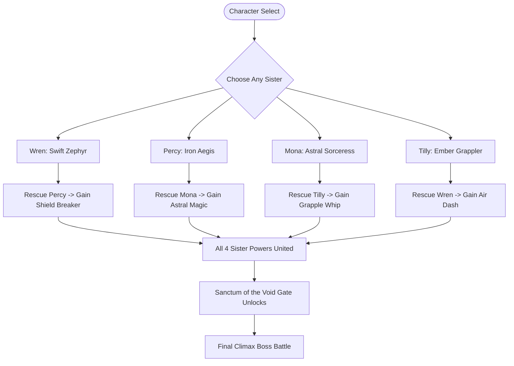

# 🌟 The Sisters of the Abyss: Metroidvania Expansion Roadmap

A phased, feature-by-feature production plan for evolving **Abyssal Blade** into a full-length, interconnected Metroidvania adventure.

> [!IMPORTANT]
> **Production Guarantee:** At the completion of each phase, the game remains 100% playable, stable, and testable directly in the browser with zero broken states.

---

## 👭 The Four Sisters & Ability Gating Matrix

### Sister Profiles & Signature Abilities

| Sister | Thematic Style & Weapon | Signature Starting Ability | Metroidvania World Gating Function |
| :--- | :--- | :--- | :--- |
| **Wren** *(The Swift)* | Feathery emerald cloak, dual twin-daggers, glowing wind drapes | **Zephyr Dash & Double Jump** | Crosses wide chasms, wind currents, and spike gaps |
| **Percy** *(The Resolute)* | Heavy silver-and-gold plate armor, kite shield, battle hammer | **Aegis Bash & Ground Slam** | Smashes cracked stone barriers, deflects heavy projectiles |
| **Mona** *(The Mystic)* | Deep starry violet robes, floating runic catalyst orb, celestial gaze | **Astral Ray & Runic Resonance** | Activates ancient crystalline conduits and spectral bridges |
| **Tilly** *(The Wildheart)* | Crimson leather scout tunic, grappling chain-whip, ember lantern | **Grappling Whip & Wall Cling** | Latches onto overhead gargoyle rings and climbs sheer ceilings |

---

## 🗺️ The World: Four Realms of the Sunken Keep

Each sister is imprisoned in a distinct themed biome guarded by a regional challenge:

1. **The Whispering Catacombs** (Hub / Starting area): Atmospheric gothic stonework and forgotten crypts.
2. **The Sunken Crystal Grotto**: Shimmering arcane caves with spectral platforms. *(Mona's sector)*
3. **The Molten Foundry**: Industrial crumbling forge with crushing hazards and lava pits. *(Percy's sector)*
4. **The Howling Spire**: Wind-whipped vertical towers and gargoyle perches. *(Wren's / Tilly's sector)*
5. **The Sanctum of the Void**: The central sealed fortress requiring all 4 sisters' powers to breach.

---

## 🚀 Phased Production Plan

### Phase 1: The Four Sisters & Character Select Screen (COMPLETED ✅)
**Goal:** Introduce Wren, Percy, Mona, and Tilly with distinct sprites, animations, playstyles, and a character select menu.
- [x] Custom pixel/vector sprites and animations for all 4 sisters in `SpriteGenerator.js` & `SisterSpriteGenerator.js`:
  - Wren: Emerald cloaks, nimble running gait, fast twin-blade slashes, air dash trail.
  - Percy: Polished armor, heavier footsteps, hammer strike with ground shock, shield raise.
  - Mona: Flowing starry robes, floating levitation step, astral projectile orb, magic surge.
  - Tilly: Crimson scout gear, acrobatic flips, whip strike arc, ember flame spark.
- [x] Interactive **Character Select Screen** (`CharacterSelectScene.js`):
  - Sister portraits, lore descriptions, and starting ability cards.
  - Smooth keyboard / click selection with audio chime.
- [x] Sister-specific starting stats (speed, jump velocity, attack cadence) in `Player.js` and custom HUD in `UIScene.js`.
- [x] In-game **Pause Menu** with **Restart Run**, **Choose Sister**, and **Title Screen** options.
- **Deliverable Milestone:** Game starts at Character Select; choosing any sister loads them into the playable world with their custom look and mechanics.

---

### Phase 2: Ability System & Sister Rescue Encounters (COMPLETED ✅)
**Goal:** Build the ability inheritance system and place the 3 remaining sisters in the world to be rescued.
- [x] Implement the **Ability Matrix Manager**:
  - Ability flags: `hasDash`, `hasShieldBash`, `hasAstralRay`, `hasGrapple`.
  - Chosen character starts with 1 signature ability; others start locked.
  - Gaining abilities from rescued sisters unlocks new active hotkeys and visual effects in real time.
- [x] Add Metroidvania obstacle objects:
  - **Cracked Stone Walls**: Shattered by Percy's Aegis Bash (`F`/`U`).
  - **Overhead Anchor Rings**: Latched onto by Tilly's Grapple Whip (`V`/`O`) to vault upward.
  - **Arcane Switches / Pedestals**: Activated by Mona's Astral Ray (`R`/`I`) to materialize hard-light bridges.
  - **Extended Chasms**: Cleared by Wren's Zephyr Air Dash (`Shift`/`L` in mid-air).
  - **4-Sister Sanctum Gate**: Unlocks only when all 4 sister abilities are united!
- [x] Design **Sister Reunion Chambers & Dialogue**:
  - 3 chambers placed in the world where imprisoned sisters float in stasis bubbles.
  - Proximity rescue prompt `[E] RESCUE [SISTER]`.
  - Full-screen dialogue modal featuring high-res sister portraits and heartfelt reunion dialogue.
  - Radiant ability bestowal fanfare and dynamic HUD ability bar update.
- **Deliverable Milestone:** Players can explore, rescue sisters, inherit their powers, and use them to access previously blocked paths.

---

### Phase 3: World Expansion & Interconnected Biomes (COMPLETED ✅)
**Goal:** Expand the map from 1 level into an interconnected multi-biome Metroidvania map.
- [x] Create distinct biome tilesets and parallax backgrounds:
  - Whispering Catacombs (Gothic stonework, bonfire shrine, hub crossroads).
  - Sunken Crystal Grotto (cyan/violet luminescent crystal platforms, glowing stalactites).
  - Molten Foundry (riveted iron plates, industrial bronze grates, bubbling lava hazard pits).
  - Howling Spire (weather-worn ivory cathedral parapets, moonlit tempest skies).
  - Sanctum of the Void (cosmic void rift, cosmic pillars, sealed 4-sister gate).
- [x] Room transition & mini-map system:
  - Seamless 5,400 x 2,200 px world map coordinate space with smooth camera follow.
  - On-screen top-right **HUD Mini-Map** tracking real-time player location, discovered sectors, and sister chambers.
  - Full-screen **Ancient Cartographer's Map modal** (toggled with `M` key) with exploration percentage, sector breakdown, and biome legend.
  - Cinematic **Biome Discovery Arrival Banners** with sound fanfares upon entering new territories.
- [x] New enemy families tailored to each biome:
  - Grotto: **Arcane Wisps** (celestial floating orbs that cast starlight sparks).
  - Foundry: **Magma Sentinels** (heavy obsidian golems that execute volcanic ground slams and spit magma).
  - Spire: **Storm Harpies** (predatory winged fiends that dive-bomb players from above).
- [x] Imprisoned sister chambers distributed into their respective thematic biomes (Mona in the Grotto, Percy in the Foundry, Tilly/Wren in the Spire).
- **Deliverable Milestone:** Full exploration map with seamless room transitions, distinct visual themes, mini-map fog-of-war, and biome-specific foes.

---

### Phase 4: Sister Campfire Hub & Narrative Depth (COMPLETED ✅)
**Goal:** Give emotional weight, camaraderie, and strategic depth to the sisters' journey.
- [x] Implement **The Sisters' Haven** (Central Bonfire Hub at Whispering Catacombs `x: 800, y: 1626`):
  - Ambient flickering campfire haven glow with golden firelight particles.
  - Interactive Campfire Shrine with proximity prompt `[E] REST AT CAMPFIRE` and mouse click support.
  - **Full-Screen Haven Modal** (`UIScene.js`):
    - **Rest & Heal**: Fully replenishes Health & Soul, saves checkpoint, and plays soothing acoustic chime.
    - **Switch Lead Sister**: Open dynamic sister swapping selector without resetting run or losing progression.
    - **Ancient Keepsake Tracker**: Real-time display of all 4 keepsakes with active stat bonuses.
- [x] **Dynamic Lead Sister Swapping System**:
  - Swap between Wren, Percy, Mona, and Tilly directly at the campfire hub or menu.
  - Instantly updates player textures, animations, stats, mobility, and HUD crest/avatar/colors.
  - All accumulated keepsakes, max health/soul upgrades, and unlocked abilities remain shared across the family.
  - The sister swapped out takes her restful seat by the campfire with the gathered sisters.
- [x] **Sister Campfire Banter & Lore Modals**:
  - Rescued sisters gather at the central campfire with breathing animations and proximity prompts (`[E] TALK TO [NAME]`).
  - High-resolution bust portraits with glowing aura borders tailored to each sister.
  - Multi-tier dynamic dialogue trees with "Next Thought" button:
    - Heartfelt sisterly banter & reunion reflections.
    - Combat advice and signature technique tips.
    - Direct lore clues pointing to hidden Ancient Keepsakes in the world (with dynamic gratitude lines if already retrieved!).
- [x] **4 Ancient Sister Keepsakes & Upgrades**:
  - **Wren's Zephyr Ribbon** (+25 Max Health): Hidden in the Catacombs upper crypt rafters (`x: 650, y: 1370`).
  - **Percy's Aegis Crest** (+25 Max Health): Hidden behind a cracked wall in the Molten Foundry (`x: 2750, y: 1890`).
  - **Mona's Astral Stardial** (+25 Max Soul): Placed on a high crystal pinnacle in the Sunken Grotto (`x: 680, y: 640`).
  - **Tilly's Scout Charm** (+25 Max Soul): Placed on an aerial gale roost in the Howling Spire (`x: 3450, y: 270`).
  - Shimmering floating animations, golden particle bursts, discovery fanfare (`playKeepsakeCollect()`), and HUD stat bar expansion.
- **Deliverable Milestone:** A cozy central refuge where your family of sisters gathers, shares advice, swaps leadership, and empowers each other with ancient relics.

---

### Phase 5: The Grand Climax & 4-Sister Boss Battle (COMPLETED ✅)
**Goal:** The ultimate challenge requiring mastery of all 4 abilities.
- [x] **The Sanctum of the Void Gauntlet** (`x: 3950 to 4400`):
  - A multi-tiered dungeon gauntlet demanding rapid chaining of Percy's Shield Bash (cracked void wall), Mona's Astral Ray (spectral bridge over spikes), Tilly's Grapple (anchor rings across chasm), and Wren's Zephyr Air Dash (long leap to the 4-sister barrier).
- [x] **3-Phase Climax Boss: Malakor Unbound (600 Max HP)**:
  - **Phase 1: Heavy Void Strikes & Ground Shockwaves (600 to 400 HP)**:
    - Flashing telegraph lunges deflectable with Percy's Shield Bash (`F`/`U`), stunning Malakor and inflicting +50 deflection counter damage.
  - **Phase 2: Aerial Void Storm (400 to 200 HP)**:
    - Malakor levitates high into the storm sky (`y: 1420`), dropping void meteors on the arena floor.
    - Grapple up using Tilly's Grapple on elevated anchor rings and air dash with Wren to strike him in mid-air, crashing him to the floor stunned for heavy combos.
  - **Phase 3: Astral Void Aegis & Void Fury (200 to 0 HP)**:
    - Malakor shields himself in an impenetrable Astral Aegis (`boss_astral_barrier`) that deflects physical attacks for 0 damage.
    - Shattered only by Mona's Astral Ray (`R`/`I`), breaking his shield and stunning him for the decisive 4-sister finishing combo!
  - **Dynamic Multi-Phase Boss HUD**:
    - Triple-phase boss health bar dynamically shifting from Void Purple (Phase 1) to Astral Cyan (Phase 2) to Blood Crimson (Phase 3).
- [x] **Cinematic 4-Sister Victory Epilogue** (`UIScene.js`):
  - Grand full-screen victory ending screen featuring all four sisters side-by-side (Wren, Percy, Mona, Tilly) with radiant portrait auras, sister titles, triumphant quotes, campaign trophies, and "Play Again" / "Return to Haven" options.
- **Deliverable Milestone:** A complete beginning-to-end playable Metroidvania campaign with an epic multi-phase climax boss and celebratory ending!

---

### Phase 6: Audiovisual Polish & Gamepad Support (COMPLETED ✅)
**Goal:** Polish to commercial indie-game standard.
- [x] **Procedural Sister Musical Themes** (`SoundFX.js`):
  - **Wren's Leitmotif**: Celtic Zephyr Wind Flute (E minor pentatonic, shimmering vibrato and airy runs).
  - **Percy's Leitmotif**: Stalwart Iron Aegis Cathedral Fanfare (D minor brass fifths and resonant low bells).
  - **Mona's Leitmotif**: Astral Weaver Starlight Celesta (Ethereal harmonic minor space chimes with celestial harmonics).
  - **Tilly's Leitmotif**: Wildheart Scout Ember Lute (Nimble, syncopated Celtic folk jig plucks).
  - Dynamic ambient lead-sister progression: Background BGM dynamically adapts its overtone timbre to whichever sister is currently leading!
- [x] **Comprehensive Gamepad / Controller Support** (`GamepadManager.js`):
  - Universal support for Xbox, PlayStation DualShock/DualSense, Nintendo Switch Pro, and standard USB gamepads.
  - Analog stick deadzone filtering, D-Pad digital directional navigation, and edge-triggered button states (`justDown`).
  - Native dual-rumble haptic vibration on melee impacts, parries, and damage.
  - Dynamic HUD prompts: Intelligently detects whether keyboard or gamepad was pressed last and swaps hotkeys in real time (`[E]` vs `[B]`, `[Shift]` vs `[RT]`, `[Z]` vs `[X]`, `[F]` vs `[LT]`, `[R]` vs `[LB]`, `[V]` vs `[R3]`).
- [x] **Persistent Save / Load System** (`SaveManager.js`):
  - Automatic serialization to `localStorage`: Remembers active lead sister, all rescued sisters, inherited abilities, collected keepsakes, max health/soul upgrades, and mini-map fog-of-war discovery.
  - Auto-saves at Campfire Haven rest, sister reunions, keepsake collection, and boss triumph.
  - Title Screen & Pause Menu integration: `CONTINUE EXPEDITION` button instantly resumes from sanctuary with full state intact; `SAVE PROGRESS` option inside Pause menu.
- [x] **Audiovisual Polish & Sound Controls**:
  - In-game HUD Audio Mute button (🔊 / 🔇) with instant toggle and status toasts.
  - Gamepad connection badge (🎮) in top-right HUD.
  - Pause Menu overhauled into **Sanctuary Retreat** with resume, save, audio toggle, and controller mappings guide.
- **Deliverable Milestone:** A commercially polished, fully controller-ready Metroidvania chronicle with rich procedural music, haptics, and robust save/load progression!

---

### Phase 6.5: Massive Room-Scale World Expansion & Multi-Room Dungeon Architecture (COMPLETED ✅)
**Goal:** Expand the world from a compact 5,400px micro-map (traversable in 20 seconds) into a sprawling 60–80+ room interconnected labyrinth that takes 3 to 6+ hours of deliberate exploration, platforming, and combat to conquer.

- [x] **Multi-Room Discrete Chamber Architecture (`RoomManager.js` & World Graph)**:
  - Transition from a single cramped 5,400px continuous coordinate space into a modular interconnected world graph of **60 to 80+ distinct chambers** across all 5 biomes (12–18 rooms per biome).
  - Screen-edge camera bounding per room with smooth sliding transitions, doorway portals, and vertical elevator shafts.
  - Continuous camera tracking safety net: Dynamic boundary expansion, Euclidean-distance room resolution, and hysteresis prevents losing track of player during fast vertical falls across multi-section chasms.
- [x] **The 4 Primordial Sigils & Sanctum Gate Lockout (Core Campaign Arc)**:
  - The final Climax Gauntlet (Malakor's Void Sanctum) is sealed behind the impenetrable **Great Void Bastion Gate**.
  - Breaking the seal requires assembling all **4 Primordial Sigils** held by the Regional Guardians:
    - *Sigil of the Crypt* (held by Ossian the Crypt Warden in Whispering Catacombs).
    - *Sigil of the Prism* (held by Caelith the Prismatic Weaver in Sunken Grotto).
    - *Sigil of the Forge* (held by Ignis the Obsidian Colossus in Molten Foundry).
    - *Sigil of the Gale* (held by Zephyra the Queen of the Tempest in Howling Spire).
  - Eliminates the ability to bypass the game in 5 minutes; beating the game strictly demands conquering all 4 biomes.
- [x] **Cross-Biome Ability Gating & Key Item Progression**:
  - **Inter-Biome Dependencies**:
    - Reaching the deep **Sunken Grotto** requires **Wren's Zephyr Air Dash** from the Catacombs.
    - Unlocking the **Molten Foundry** blast gates requires **Mona's Astral Ray** from the Grotto to ignite thermal conduits.
    - Ascending the **Howling Spire** elevator shaft requires **Percy's Shield Bash** to break rusted iron counterweights.
    - Navigating the **Sanctum Chasm** requires **Tilly's Grapple Whip** across distant floating rings.
  - **Ancient Relic Keys**: Key doors and locked iron portcullises requiring distal exploration keys (*Ossuary Key*, *Prism Core*, *Smelter Valve Wheel*, *Grand Archives Seal*) hidden in puzzle rooms.
- [x] **Verticality, Platforming Hazards & Looping Metroidvania Shortcuts**:
  - Multi-tiered vertical shafts featuring crumbling platforms, moving cogwheels, lava geysers, hard-light crystal timing bridges, and wind updraft tunnels.
  - One-way ledges and mechanical lever-operated shortcut gates that loop deep dungeon branches back to the Haven Campfire and regional Leyline waypoints.
- [x] **Lockdown Combat Arenas & Trial Chambers**:
  - Key junction chambers that seal iron portcullises on entry, spawning waves of biome-specific enemies that must be conquered to unlock the path forward and claim key items.
- **Deliverable Milestone:** A legitimate, sprawling multi-hour Metroidvania world graph where exploration, key hunting, puzzle navigation, and boss mastery require hours of dedicated gameplay.

---

## ⚔️ Extended Odyssey Roadmap: Phases 7 to 12

### Phase 7: Hack-and-Slash Combat Evolution & Sister Tag-Team Assists (COMPLETED ✅)
**Goal:** Evolve basic combat into fluid, expressive character-action mechanics with aerial juggling, parrying, and sister synergy summon attacks.
- [x] **Aerial Combat & Juggle Physics** (`Player.js`):
  - Uppercut launcher move: Holding `Up` + Attack launches standard foes into the air.
  - Mid-air 3-hit aerial sword combo maintaining airborne suspension.
  - Downward aerial dive-strike: Pressing `Down` + Attack in mid-air plunges downward with a ground-shattering shockwave.
- [x] **Precision Parry & Deflect Counter** (`Player.js` & `SoundFX.js`):
  - Timed guard/block window: Parrying an incoming strike within 200ms triggers a dynamic hit-stop pause, golden spark flash, and +100% critical counter-attack window.
  - Haptic controller rumble and resonant metallic clashing sound effect.
- [x] **Sister Tag-Team Assist Summon Attacks** (`Player.js`, `UIScene.js`, `SoundFX.js`):
  - Dedicated Tag-Team trigger (`[LT] + [RT]` or keyboard `Tab` / `T`):
    - **Mona's Starlight Prism**: Freezes all enemies on screen in crystalline starlight for 3.2 seconds.
    - **Percy's Earthshaker Slam**: Leaps in from above, slamming a seismic shockwave that stuns heavy enemies and breaks shields.
    - **Tilly's Snare Whip**: Latches onto evasive and flying foes, pulling them into point-blank range for easy combo extensions.
    - **Wren's Zephyr Cyclone**: Whirlwind spin that shreds enemy groups and deflects ranged projectiles.
- [x] **Visceral Execution Finishers**:
  - Heavily staggered or low-health enemies flash with an execute beacon; pressing Interact (`[B]` / `E`) triggers a cinematic finishing slash dropping guaranteed health and soul orbs.
- **Deliverable Milestone:** Deep, stylish character-action combat with aerial combos, satisfying parries, execution moves, and 4 distinct sister assist powers.

---

### Phase 8: Map Expansion & The 4 Regional Biome Bosses (COMPLETED ✅)
**Goal:** Transform the world into a sprawling, multi-room labyrinth with 4 unique regional bosses before the Malakor climax.
- [x] **4 Regional Biome Boss Guardians**:
  1. **The Sunken Crystal Grotto**: *Caelith, the Prismatic Weaver* (`BossCaelith.js`) — Multi-phase crystal sorceress who teleports between crystal spires, shoots refractive laser beams, and summons hard-light barriers.
  2. **The Molten Foundry**: *Ignis, the Obsidian Colossus* (`BossIgnis.js`) — Massive forge automaton with crumbling platforms, anvil slams, lava geysers, and rotating flame jets.
  3. **The Howling Spire**: *Zephyra, Queen of the Tempest* (`BossZephyra.js`) — Flying aerial dogfight boss demanding rapid grapple swings and air dashes across updraft wind tunnels.
  4. **The Whispering Catacombs**: *Ossian, the Crypt Warden* (`BossOssian.js`) — Armored guardian with a giant tower shield that deflects frontal strikes, warhammer ground tremors, and phalanx skeleton summons that demands shield-breaking tactics.
- [x] **Labyrinthine Room Architecture & Sub-Region Signifier System**:
  - Segmented multi-room layout modularized into dedicated builders (`CatacombsBuilder.js`, `GrottoBuilder.js`, `FoundryBuilder.js`, `SpireBuilder.js`, `SanctumBuilder.js`).
  - Spatial sub-region tracking via `SubRegionManager.js` and `WorldData.js` across 16 interconnected sub-regions.
  - Permanent HUD Sub-Region signifier pill: `📍 [Sub-Region Name] [machine_id]` (e.g. `📍 The Grand Archives [spire_grand_archives]`, `📍 The Smelting Crux [foundry_smelting_crux]`) for rapid location identification and debugging.
  - Cinematic Sub-Region discovery banners sliding down upon first entry with room lore.
  - Unlockable iron portcullises with mechanical wall levers looping back to earlier areas (`shortcut_portcullis`, `lever_switch`).
- [x] **Astral Leyline Fast-Travel System**:
  - Interactive Astral Leyline Stones at Haven, Grotto, Foundry, and Spire hubs.
  - Interactive Fast-Travel modal with full Gamepad / D-Pad and Keyboard navigation.
- **Deliverable Milestone:** A sprawling multi-room dungeon map with 4 distinct regional guardian boss encounters, sub-region signifiers, and fast-travel convenience!

---

### Phase 9: Economy, Sanctuary Merchant & The Rune Charm System
**Goal:** Deep RPG build-crafting, character customization, and exploration incentives.
- [ ] **Void Ember Currency & Drop Economy**:
  - Defeated enemies and hidden chests yield shimmering *Void Embers*.
- [ ] **The Blind Archivist (Sanctuary Merchant NPC)**:
  - Mysterious robed vendor stationed near the Campfire Haven.
  - Sells permanent health/soul vessel upgrades, map compasses, and rare charms.
- [ ] **Socketable Rune Crest (Charm) System** (`UIScene.js` & `Player.js`):
  - Limited notch system (start with 3 notches, find more in hidden gauntlets).
  - Collectible charms:
    - *Vampiric Edge*: Slashing bleeding enemies restores 2 HP.
    - *Zephyr Slipstream*: Dashing leaves a cutting gale trail that slices foes behind you.
    - *Celestial Overcharge*: Soul Bolts explode into tracking starlight homing darts.
    - *Bulwark's Retribution*: Successful parries generate 25 bonus Soul energy.
    - *Ember Compass*: Vibrates controller when near secret illusionary walls or hidden keepsakes.
- [ ] **Heart & Soul Vessel Shards**:
  - 12 hidden vessel fragments scattered across secret platforming gauntlets (collect 3 to permanently increase max capacity).
- **Deliverable Milestone:** An addictive collection and build-crafting loop with customizable charms, currency, and permanent stat upgrades.

---

### Phase 10: Deep Enemy Ecology & Combat Gauntlet Arenas
**Goal:** Diversify enemy tactics and create high-intensity battle trial chambers.
- [ ] **12+ Biome-Specific Enemy Archetypes**:
  - *Catacombs*: Phalanx Skeletons (shielded; must be bashed or back-stabbed), Vampire Bats (swoop from ceilings), Crypt Necromancers (resurrect fallen mobs).
  - *Grotto*: Crystal Crawlers (reflect magic bolts), Phase Stalkers (teleporting melee assassins), Arcane Snipers.
  - *Foundry*: Molten Slimes (leave burning magma trails), Iron Brutes (super-armored hammer swings), Steam Vent Turrets.
  - *Spire*: Gale Harpies (air-dash dive-bombs), Lightning Shamans (call down chain lightning), Gargoyle Sentinels (stone camouflage).
- [ ] **Blood Sanctum Challenge Arenas**:
  - Optional locked challenge gates in each biome: waves of mixed enemy combinations that lock the doors until defeated, rewarding legendary charms and high Void Ember caches.
- **Deliverable Milestone:** High enemy variety demanding diverse tactics, ability usage, and mastery of all four sisters' skill sets.

---

### Phase 11: Secrets, Illusion Walls & Sister Personal Quests
**Goal:** Elevate world exploration with hidden lore, secret chambers, and emotional narrative payoffs.
- [ ] **Destructible Secret Illusion Walls**:
  - Cracked walls, false stone illusions, and hidden ceilings revealed by weapon strikes or subtle visual cracks.
- [ ] **Four Sister Personal Memory Chambers**:
  - Finding each sister's personal sanctuary room triggers an emotional memory dialogue and unlocks her **True Master Ability**:
    - *Wren's Gale Tempest*: Triple Air Dash with invulnerability frames.
    - *Percy's Aegis Bulwark*: 360-degree projectile absorption shield.
    - *Mona's Cosmic Singularity*: Black hole spell that draws in all small enemies and detonates.
    - *Tilly's Inferno Tether*: Grapple can latch directly onto heavy enemies, pulling player straight to them with a flaming dropkick.
- [ ] **Secret 5th Ending (The True Unbound Restoration)**:
  - Gathering all 4 memories and defeating Malakor unlocks the True Golden Ending where the Sunken Keep's curse is permanently purified.
- **Deliverable Milestone:** High replayability, lore discovery, true master skills, and multiple campaign endings.

---

### Phase 12: Visual & Audio Masterclass
**Goal:** Deliver breathtaking gothic atmosphere and commercial-grade audiovisual spectacle.
- [x] **Panoramic Parallax Vistas & Multi-Plane Depth**:
  - Replaced repetitive tile grids with full-screen viewport-pinned panoramic `TileSprite` vistas (Cathedral Citadel, Crystal Grotto, Molten Foundry, Howling Spire, Void Sanctum).
  - Continuous 0.18x horizontal parallax depth with zero vertical tiling glitches, seams, or cross-biome leaks.
  - Smooth cinematic cross-fades (~0.35s lerp) when traversing across biome boundaries.
- [x] **Fluid Multi-Frame Attack Combo Suite**:
  - Transformed single-frame attacks into keyframed 13-frame combo suites (4-frame Strike 1, 4-frame Strike 2, 5-frame Heavy Finisher).
  - Integrated anticipations, explosive forward lunges, radiant crescent energy smear arcs with white cutting edges, and follow-through recoveries.
  - Unique weapon handling and particle smears customized per Sister (Wren's twin daggers, Percy's warhammer, Mona's celestial scythe, Tilly's ember whip).
- [ ] **Cinematic Boss Intro Splash Cards**:
  - Dramatic title cards with gothic calligraphy, Latin subtitles, and custom fanfare chords when entering any boss arena.
- [ ] **Adaptive Orchestral Audio Layering** (`SoundFX.js`):
  - Dynamic BGM layering: Ambient exploring layers seamlessly morph into intense battle percussion upon encountering enemies or bosses, and ease into intimate acoustic strings at the Haven.
- **Deliverable Milestone:** A visually stunning, atmospheric dark fantasy Metroidvania that looks and sounds on par with premier indie titles.

